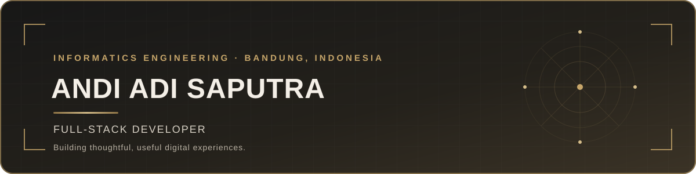
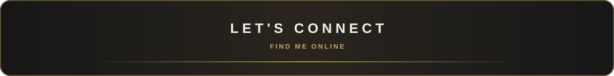
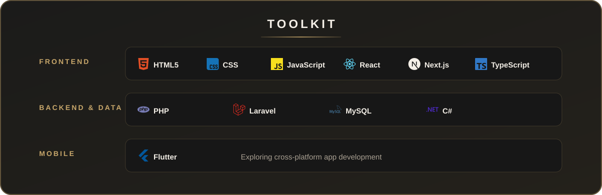
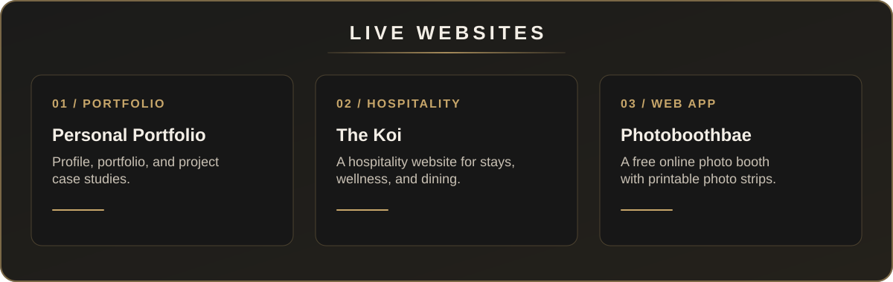
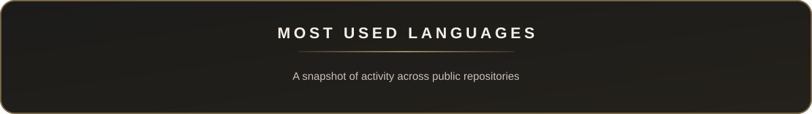

  

 

  

LEARN · BUILD · EVOLVE

  Open to internship opportunities

 

  

 

  

  
  

<!-- Copy a badge link to add a website. Update live-websites.svg too to include it in the gold panel. -->

 

  

  

 
